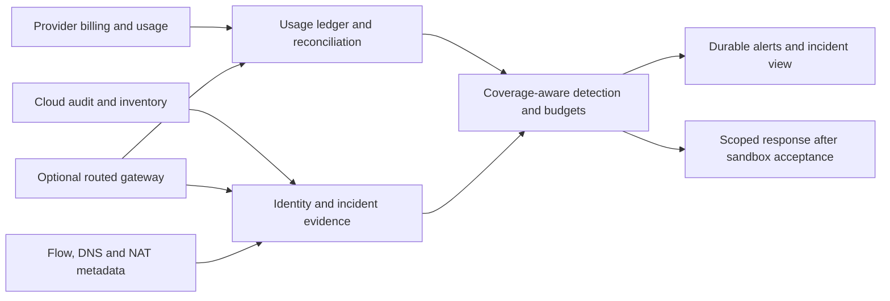

# Prahari pilot plan and repository assessment

**Updated:** 2026-10-12. **Team:** solo founder with AI assistance. **First sources:** GCP + OpenAI. **Deployment:** customer-owned India cloud; India SaaS later. This is the current execution plan. Older roadmap documents preserve historical work breakdowns. Decisions and actual evidence belong in [DECISIONS.md](DECISIONS.md) and [PROGRESS.md](../PROGRESS.md).

## Product judgment

The problem is real enough to investigate, but a unified token dashboard is already a crowded category. [Market research](MARKET_RESEARCH.md) documents substantial overlap from observability, FinOps and gateway vendors. The startup hypothesis combines useful daily cost visibility by trusted person/team/account with identifying suspicious AI spend, explaining evidence/coverage, responding safely and reconciling the eventual bill. [USER_COST_VISIBILITY.md](USER_COST_VISIBILITY.md) clarifies the founder's ordinary-consumption use case and source limits; the product is not limited to service-account compromise.

Start with one weekend abuse drill and one legitimate burst. A useful incident view shows what happened, what is known, what is missing, when each source arrived, who owns the affected resource, and which action actually took effect. Exact per-employee attribution requires trusted identity. A shared service account or API key alone cannot supply it. Compare Google's native anomaly/spend-cap workflow before writing a custom cloud control; reuse supported controls when they satisfy the customer scope.

Do not pitch “every token,” universal real-time billing, guaranteed India processing, or unique budget controls. Earn a narrower claim with measured coverage and comparison against the customer's existing stack. Interview startup/midmarket and regulated enterprise buyers separately; reuse one technical core.

## What the repository contains

The original repository provides a useful Python prototype, rather than a production control plane. Its main components are:

| Component | Existing purpose | Current practical limit |
|---|---|---|
| `core/models`, `money`, `fx` | Normalize consumption, allocation and money | A FOCUS-inspired schema is not certified conformity; source mappings and dated pricing still need acceptance. |
| `connectors/openai`, `anthropic` | Organization usage and cost API clients | Mocked contracts must meet live APIs. Usage estimates and invoice costs have different grain; do not add both into one ledger total. |
| `connectors/gcp` | BigQuery billing ingestion and service classification | Billing does not supply per-caller identity or a delivery/completeness SLA. No GCP audit ingestion exists yet. |
| `detect/aggregate`, `rules` | Credential/project baselines and explainable anomaly rules | Project fallback is not a service-account finding. Synthetic calibration is not production precision/recall. |
| `core/budget`, `insights` | Scoped budgets, projections and allocation reports | Enforcement is a policy result only; no provider action executor exists. Projections assume current historical behavior. |
| `store/duck`, `collector/daemon` | Local persistence, incremental collection and recovery | DuckDB is a single-process foundation; production retention, backups and scale require operational acceptance. |
| `notify/router` | Console, Slack and SMTP delivery | Provider acceptance is not human receipt. At-least-once delivery can duplicate after an ambiguous crash. |
| `pricing/vendor`, `registry` | Checksum-pinned model-price data | Integrity does not establish rate freshness. Lookup has a broad suffix fallback; provider/alias mappings need conformance before financial controls. |
| `synth`, `scripts`, tests | Deterministic incident/report demonstrations | Synthetic bucket timing excludes real source and response delays. No measured prevented loss follows. |
| Documentation and GTM files | Product hypotheses, discovery and architecture | Earlier market/legal/feature claims needed correction; current decisions supersede conflicting historical notes. |

The foundation changes preserve unknown-price activity, distinguish cost provenance, repair provider units, keep Decimal precision, require explicit FX, persist per-channel notification recovery, migrate existing records, bound fetch waits and retain older activity. These changes make the prototype safer to evaluate. They do not establish customer readiness.

## Architecture and evidence boundaries

The gateway, audit/network ingestion and response executor in this diagram are planned. Billing is the eventual accounting path; routed request telemetry is the admission-control path; provider/audit evidence covers supported direct-key bypass. Keep network observations separate from charge records so a connection never becomes a fabricated token or cost.

Record event time, receipt time, source identity, source grain, cost basis, allocation evidence and coverage separately. Join exact request IDs where supplied. Time/project matches remain estimates or candidate links. Reconcile estimated and billed layers; never sum overlapping representations as new spend.

## Work sequence and acceptance

These are planning ranges, not delivery promises. A solo-founder pilot could take roughly 12–20 weeks with usable accounts and responsive partners; procurement and unsupported telemetry can extend it. Work stops or narrows at failed evidence gates, rather than adding more connectors to compensate.

| Phase | Work and concrete output | Exit evidence |
|---|---|---|
| Foundation: current change | Repair accounting/recovery/security boundaries; publish research, plan and decisions on a separate branch. | Local suite/lint/registry checks pass; unresolved live/container limits are visible. |
| Source feasibility: weeks 1–3 | Connect an authorized GCP + OpenAI sandbox; capture sanitized fixtures, method coverage, permissions, pagination and source-delay distributions. Add a read-only GCP audit path only for verified methods. | Measured event-to-available and event-to-alert delays; documented missing principals/tokens/IPs. No exact audit-to-token join without evidence. |
| Accounting and incident workflow: weeks 3–6 | Separate usage estimates from billed charges; reconcile a settled period, invoice corrections and unallocated money. Build the smallest read-only incident/coverage view. | Target ≤2% aggregate variance per provider with explanations; users can trace a displayed number and identify missing attribution. |
| Routed controls: weeks 6–10 | Reuse one reviewed gateway; trusted workload/employee tags, request cost reservation, concurrency accounting, cancellation and stream finalization. | Budget tests include concurrent calls, retries, delayed usage, unavailable state and direct-key bypass. Publish maximum measured in-flight exposure. |
| Response and network evidence: weeks 9–13 | Validate a scoped provider response adapter in a sandbox; ingest existing network logs for one workload using [NETWORK_TELEMETRY.md](NETWORK_TELEMETRY.md). | Action is audited and its effect confirmed, with rollback/blast radius; network findings disclose sampling, routes and unmatched evidence. |
| Paid pilots and repeatability: weeks 10–20 | Onboard partners, measure support burden, false alerts, cost per successful task and avoided exposure only when demonstrable. | Target three paid partners and two renewals/expansions; measured installation and operating economics. |

Discovery starts immediately and runs alongside source work. Do not wait for a polished dashboard. Use [DECISION_GATES.md](DECISION_GATES.md) to decide whether to continue, narrow the buyer/wedge, or integrate into another product. A live-source failure can change architecture; a buying failure can change the product.

## Hard problems and how to handle them

| Problem | Why it matters | Approach and limitation |
|---|---|---|
| Source delay and omissions | An hourly polling loop cannot detect data that has not arrived. | Measure each method and expose freshness/coverage; independent audit or routed signals help only where available. No billing SLA claim. |
| External stolen-key use | A gateway and customer VPC can both be bypassed. | Use provider-side audit/usage plus supported IAM/network restrictions. Demonstrate the blind spot in every pilot. |
| Identity attribution | Shared keys, delegation, NAT and missing tags create false certainty. | Customer ownership maps and trusted application identity; expose unallocated/candidate attribution and validity periods. |
| Money correctness | Cached/reasoning/batch/multimodal tokens, credits, negotiated rates, FX and revisions differ. | Provider-specific mappings, unknown-price warnings and separate reconciled totals. Retain source units and version pricing. |
| Distributed admission | Requests can race budgets and complete after a cutoff. | Reserve conservatively and settle actual usage atomically in the chosen gateway/store. A routed cap cannot stop unrelated direct traffic. |
| Response effectiveness | Key disablement may leave minted tokens usable; broad actions disrupt valid work. | Verify the actual provider action and effect, least privilege, rollback and customer approval mode. Automatic cloud shutdown comes later. |
| Detector trust | Deployments, batch jobs and seasonality resemble attacks. | Explain findings, calibrate on legitimate bursts and cold starts, track precision/misses by source; do not infer fraud from IP country alone. |
| Telemetry cost | Flow logs, BigQuery scans and high-cardinality traces can become a second bill. | One workload first, sampling/retention controls, bounded queries and daily monitoring of Prahari's own cost. |
| Sensitive metadata | IPs, principal IDs and DNS names can identify people or expose internal systems. | Payload-free allowlisted fields, least privilege, customer retention, masking and reviewed alert/support destinations. |
| Supplier/dependency risk | Gateway adapters and model pricing change; upstream incidents can expose secrets. | Reviewed pinned versions/images, provenance and license notices. Reuse does not replace supplier review. |
| Founder capacity | Each provider/cloud/customer customization adds an operational tax. | Two providers and one core first; reject bespoke connectors without repeatable paid demand. |

Do not assume one public OSS issue proves a whole project unreliable or one closed issue proves a deployed version fixed. Evaluate the exact pinned candidate with a small conformance fixture and failure drill. [OSS_ASSESSMENT.md](OSS_ASSESSMENT.md) records documented limits, selected issue reports and required trials; [OSS_INVENTORY.md](OSS_INVENTORY.md) is the historical reuse shortlist. Neither is an approved dependency manifest or comprehensive source audit of every upstream repository.

## India and residency

[DPDP Act section 16](https://www.meity.gov.in/static/uploads/2024/06/2bf1f0e9f04e6fb4f8fef35e82c42aa5.pdf) is not a blanket all-data-in-India requirement. Determine the customer's data category, applicable commencement, sector rules, contracts and notified restrictions. [INDIA_REGULATION.md](INDIA_REGULATION.md) records the current/future duties and sector-specific nuances. A lawyer/customer compliance owner must decide applicability; Prahari supplies evidence and configured policy findings.

Separate where Prahari stores metadata from where the model processes requests. Inventory backups, encryption keys, notification endpoints, identity services and support access as well as primary storage. A global endpoint or mapped IP country does not establish physical inference location; verify the specific model/feature commitment. Treat unknown location as unknown and allow the customer's explicit policy to decide routing.

Customer-owned India deployment reduces central exposure but requires installation/upgrade support. India SaaS later requires tenant isolation, authentication/authorization, credential management, deletion/export, backups, incident handling and a reviewed data-processing arrangement. Do not add these as empty scaffolding before a paid pilot needs them.

## Deferred task: hourly user/account cost feasibility

**Status:** deferred at the founder's request on 2026-10-12. Resume this assessment before implementing [user cost visibility](USER_COST_VISIBILITY.md).

- [ ] Select the first usage path: company application, individual developer credentials or employee SaaS tools.
- [ ] Identify authorized GCP + OpenAI sandbox accounts and read-only integration permissions.
- [ ] Verify source fields, identity meaning, supported time buckets, pagination and cost-report granularity.
- [ ] Determine how shared credentials can carry trusted employee identity; keep unsupported attribution explicit.
- [ ] Measure source freshness and distinguish hourly estimates from reconciled billing, including timezone/FX limits.
- [ ] Validate two users across two providers, with shared-key and unattributed examples.
- [ ] Record a feasible/conditional/unsupported verdict and integration requirements before feature implementation.

No sandbox access, feasibility harness or new feature implementation was completed before this pause. Source research and the existing foundation remain available; live acceptance is pending.

## Next concrete milestone

Use a founder-owned or customer-authorized sandbox to answer four questions before promising the first pilot: can supported Gemini calls expose a usable principal; can their usage be joined to that principal; how late does each source arrive; and how does that incident workflow compare with the existing customer tooling? Capture sanitized fixtures and actual timings. Do not request production secrets in chat or use employer incident data without separate authorization.

If exact principal-level billing cannot be established, ship honest project-level billing with independently evidenced principal incidents and routed estimates. If that does not solve a paid buyer's job better than their existing stack, narrow the wedge before expanding the product.
